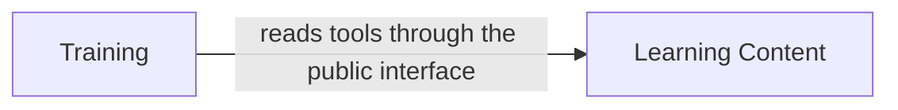

# Context Map (draft)

**Status:** agreed by J on 2026-10-27 in [TWA-4.1](../product_backlog/backlog.md#twa-41--bounded-contexts).

The bounded contexts of Tech Wise Academy. The backend is one application with one module per
bounded context ([ADR-0001](../adr/0001-architecture-concept.md)); each module owns its tables,
and modules call each other only through a small public interface.

## Contexts

| Context | Module | Responsibility | Owns | Status |
|---------|--------|----------------|------|--------|
| Learning Content | `learning_content` | The content users learn from: tools with hints, code examples and alternatives; later learning packs and paths | `tool`, `tool_hint`, `tool_example`, `tool_alternative` ([data model](../data_model/learning-content-data-model.md)) | first code in TWA-4 |
| Training | `training` | Game rounds and the learning progress of each user | `learning_progress` | first version for Level 0 (answers per tool and profile); rounds and more games follow in MS 2 |
| Identity and Access | – | Users and the roles USER and ADMIN | – | not a module yet; depends on TD-17 |

## Relationships

- **Training depends on Learning Content** (customer / supplier, read only): it reads tools to build
  game rounds; Learning Content knows nothing about Training.
- References from one module to another are plain IDs or keys, without foreign keys across
  modules.
- Identity and Access is a generic domain: the decision on the identity provider (TD-17) comes
  before the first protected endpoint.

## Ubiquitous Language

| Term | Meaning |
|------|---------|
| Tool | A tool or technology that users learn about, e.g. Docker |
| Category | One of five areas a tool belongs to: DevOps, backend, frontend, security, AI and data |
| Hint | A description of a tool that neither names it nor shows its icon; several per tool and language, in order |
| Example | A typical command or code snippet of a tool |
| Alternative | Another tool that can be used instead; the relation is symmetric |
