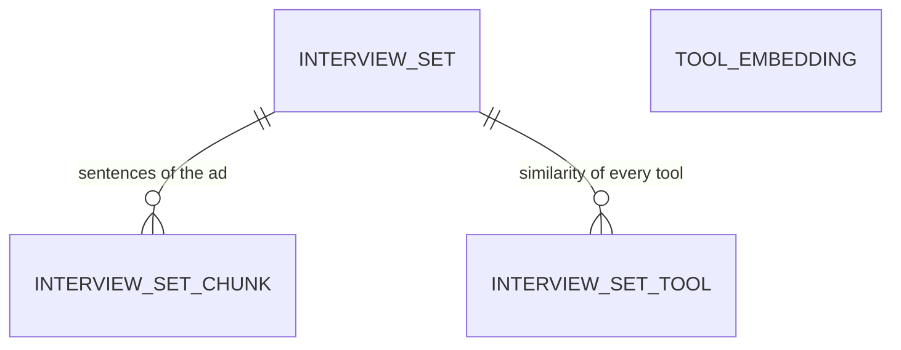

# Data Model – Interview

**Status:** implemented in [TWA-8](../product_backlog/backlog.md#epic-twa-8--interview-preparation),
migration `0008`. The decisions behind it are in [ADR-0006](../adr/0006-local-semantic-matching.md).
This is the first version, built before [ADR-0006](../adr/0006-local-semantic-matching.md) was
written (Ollama, `bge-m3`); it changes with the decisions there, which are still open.

The tables of the module `interview`. References to tools are plain keys without a foreign key,
because tools belong to another module (see the [context map](../architecture/context-map.md)).

## Overview

| Table | Purpose |
|-------|---------|
| `tool_embedding` | The vector of each tool, per model |
| `interview_set` | A set: the pasted ad, its title, the model and the profile it belongs to |
| `interview_set_chunk` | The sentences of the ad with their vectors |
| `interview_set_tool` | **The persisted similarity values:** one row per tool of the catalogue, also for tools without a card |

**Vectors have no fixed dimension.** The columns use the pgvector type `vector` without a length, so
the model can be changed by configuration without a migration. Vectors of different models are never
compared: every query filters by `model`. An index on a vector column needs a fixed dimension; none
is needed for about 300 tools (see [ADR-0006](../adr/0006-local-semantic-matching.md)).

## tool_embedding

| Field | Type | Required | Provided | Description |
|-------|------|:--------:|----------|-------------|
| tool_key | text | ✓ | generated | Key of the tool |
| model | text | ✓ | generated | Name of the embedding model, e.g. `bge-m3` |
| text_hash | text | ✓ | generated | SHA-256 of the embedded text (name, summary, hints); a changed text is embedded again |
| embedding | vector | ✓ | generated | The vector |

- Primary key: (`tool_key`, `model`).
- The rows are derived data. They are filled on the first generation of a set, updated on later ones,
  and can be deleted at any time.

## interview_set

| Field | Type | Required | Provided | Description |
|-------|------|:--------:|----------|-------------|
| id | UUID | ✓ | generated | Primary key |
| profile_id | UUID | ✓ | input | The anonymous profile (header `X-Profile-Id`), until the login exists (TD-17) |
| title | text | ✓ | generated | The first line of the ad, at most 80 characters |
| job_ad | text | ✓ | input | The pasted text, unchanged, at most 20,000 characters |
| model | text | ✓ | generated | The model of its vectors and similarity values |
| created_at | timestamptz | ✓ | generated | Time of creation |

## interview_set_chunk

| Field | Type | Required | Provided | Description |
|-------|------|:--------:|----------|-------------|
| set_id | UUID → `interview_set.id` | ✓ | generated | The set; chunks are deleted with it |
| position | integer | ✓ | generated | Order within the ad, from 0 |
| text | text | ✓ | generated | One line or sentence of the ad, at most 300 characters |
| embedding | vector | ✓ | generated | The vector of this text |

## interview_set_tool

| Field | Type | Required | Provided | Description |
|-------|------|:--------:|----------|-------------|
| set_id | UUID → `interview_set.id` | ✓ | generated | The set; the values are deleted with it |
| tool_key | text | ✓ | generated | Key of the tool |
| similarity | double precision | ✓ | generated | Cosine similarity between the tool and its closest chunk, computed by pgvector |
| chunk_position | integer | ✓ | generated | The chunk behind the value: the one that names the tool, otherwise the closest one |
| mentioned | boolean | ✓ | generated | The ad names the tool |
| rank | integer, optional | | generated | Position of the card in the set; empty = the tool has no card |

- Primary key: (`set_id`, `tool_key`).
- **Every tool of the catalogue gets a row**, not only the cards. So the selection can be changed and
  checked later without calling the model again, and it stays visible how close a tool came.
- Deleting a set deletes its text, its chunks and its values.
