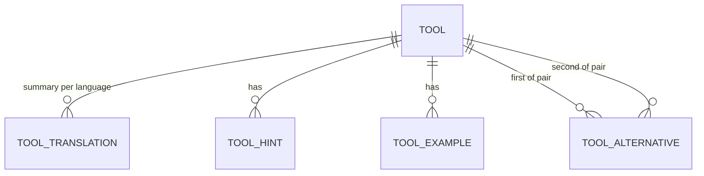

# Data Model – Learning Content (draft)

**Status:** approved by J on 2026-10-25 in [TWA-4.2](../product_backlog/backlog.md#twa-42--data-model-of-the-first-entity).
The model is approved; nothing is changed in it without a new review by J.

First entity of the module `learning_content` (proposed name, see TWA-4.1): the **Tool**, i.e. a
tool or technology that users learn about. The model is based on the learning card of the Tech Tool
Trainer, reduced to what the first end-to-end slice needs. The database is PostgreSQL, migrations
are written with Alembic ([ADR-0002](../adr/0002-backend-stack.md)).

## Overview

| Table | Purpose |
|-------|---------|
| `tool` | The tool itself: name, category, documentation link, icon |
| `tool_translation` | The one-sentence summary of a tool, one row per language |
| `tool_hint` | Several ordered hints per tool and language that describe it without naming it |
| `tool_example` | Several ordered code examples per tool (typical command or snippet) |
| `tool_alternative` | Link between two tools that are alternatives to each other |

**Provided:** `input` (from the seed migration or later from the admin), `generated` (by the system).

## Languages

Decided by J on 2026-10-25: the **first slice is German**; English follows in MS 3.

- The model already supports several languages: `language` is text with a check against the
  allowed values. In the first slice the value is `de`; `en` is added in MS 3 by a migration that
  only extends the check, without changing the tables.
- `de` is the **default language and the fallback**. A tool without a text in the requested
  language returns the German text.
- **Translated:** the summary (`tool_translation`) and the hints (`tool_hint.language`).
- **Not translated:** `key` and `name` (product names), the category (the frontend shows its
  name), code examples, `documentation_url` and `icon`.

## tool

| Field | Type | Required | Provided | Description |
|-------|------|:--------:|----------|-------------|
| id | UUID | ✓ | generated | Primary key, not part of the API |
| key | text, unique | ✓ | input | Readable short name (`kubernetes`): lowercase letters, digits and hyphens; stable for links and seed data |
| name | text | ✓ | input | Display name (`Kubernetes`); the same in all languages |
| category | enum `Category` | ✓ | input | The main category of the tool, one value, see [Category](#category) |
| level | integer `1` to `3` | ✓ | input | The level of the tool in the game, see [Level](#level) |
| documentation_url | text | ✓ | input | Link to the official documentation, for reading on |
| icon | text, optional | | input | Identifier of the tool's icon in the icon source (open decision TD-33). Empty = the frontend shows the icon of the category |

## tool_translation

The summary of a tool in one language.

| Field | Type | Required | Provided | Description |
|-------|------|:--------:|----------|-------------|
| tool_id | UUID → `tool.id` | ✓ | input | The tool; translations are deleted with the tool |
| language | text (`de`; `en` from MS 3) | ✓ | input | Language of the text |
| summary | text | ✓ | input | One sentence: what is it? Shown as the solution of a hint |
| content | JSONB, optional | | input | The learning content shown on the overview card, see below (migration 0009) |

- Primary key: (`tool_id`, `language`).
- Every tool has a row for `de`.

**Content (`content`):** structured text for learning, written in German and reviewed by J
([TWA-12](../product_backlog/backlog.md#epic-twa-12--learning-content-in-depth)). The seed field is
`content_de`, the seed tests check that every tool has all parts.

| Part | Content |
|------|---------|
| `overview` | Three to five sentences: what it is, which problem it solves, how it works at its core |
| `use_cases` | Three or four concrete uses |
| `key_concepts` | Three to five terms, each `{ term, explanation }`: the vocabulary a learner meets |
| `when_to_use` | One or two sentences |
| `when_not_to_use` | One or two sentences |
| `good_to_know` | Two or three pitfalls or facts |

To load changed content into a development database, run `alembic downgrade 0008` and
`alembic upgrade head`; a released change needs a new migration.

## tool_hint

Several hints per tool and language, in a fixed order. The hints of each language are an independent
list.

| Field | Type | Required | Provided | Description |
|-------|------|:--------:|----------|-------------|
| id | UUID | ✓ | generated | Primary key |
| tool_id | UUID → `tool.id` | ✓ | input | The tool; hints are deleted with the tool |
| language | text (`de`; `en` from MS 3) | ✓ | input | Language of the hint |
| position | integer ≥ 1 | ✓ | input | Order within the tool and language; unique per (`tool_id`, `language`) |
| text | text | ✓ | input | Description of the tool that does **not** contain its name |

**Rule (decided by J):** a hint never reveals its tool. The text does not contain the name of the
tool, and the UI does not show the icon of the tool next to a hint that is to be guessed. A small
test of the seed data checks the first part for every hint; the second part is a rule for the UI
of the games (MS 2).

## tool_example

Several code examples per tool, in a fixed order. Code is the same in all languages.

| Field | Type | Required | Provided | Description |
|-------|------|:--------:|----------|-------------|
| id | UUID | ✓ | generated | Primary key |
| tool_id | UUID → `tool.id` | ✓ | input | The tool; examples are deleted with the tool |
| position | integer ≥ 1 | ✓ | input | Order within the tool; unique per tool |
| code | text | ✓ | input | Typical command or code snippet |

Decided by J: an example consists of the code only.

## tool_alternative

Alternatives are a **many-to-many** link between two tools and are **symmetric**: if Podman is an
alternative to Docker, Docker is an alternative to Podman. Each pair is stored **once**.

| Field | Type | Required | Provided | Description |
|-------|------|:--------:|----------|-------------|
| tool_id | UUID → `tool.id` | ✓ | input | First tool of the pair |
| alternative_tool_id | UUID → `tool.id` | ✓ | input | Second tool of the pair |

- Primary key: (`tool_id`, `alternative_tool_id`); links are deleted with either tool.
- Check `tool_id < alternative_tool_id`: a tool is never its own alternative, and (A, B) and (B, A)
  cannot both exist.
- The API returns the alternatives of a tool from both sides of the pair (key and name).
- Only tools that exist in `tool` can be linked.

## Category

The main category of a tool: one of **five areas**, the same five as the learning paths of the Tech
Tool Trainer. **One value per tool** (decided by J); stored as text with a check against the allowed
values. The names and the category icons belong to the frontend. New values are added with a
migration.

| Code | Meaning |
|------|---------|
| `DEVOPS` | DevOps and platform |
| `BACKEND` | Backend development |
| `FRONTEND` | Frontend development |
| `SECURITY` | Security (DevSecOps) |
| `AI_DATA` | AI and data |

The second set, the **programming languages**, uses the same enum with five **paradigms** instead of
areas (migration 0007). A language has exactly one main paradigm; a language that is taught in
several styles is `MULTI_PARADIGM`. The set of a tool is derived from its category, so there is no
extra column.

| Code | Meaning |
|------|---------|
| `OBJECT_ORIENTED` | Object-oriented (Java, C#, Kotlin, Swift, Ruby) |
| `FUNCTIONAL` | Functional (Haskell, Elixir, Clojure, Erlang) |
| `PROCEDURAL` | Procedural (C, Go, Bash, PHP) |
| `DECLARATIVE` | Declarative (SQL, HTML, CSS, Prolog) |
| `MULTI_PARADIGM` | Several paradigms (Python, JavaScript, TypeScript, Rust, Scala, C++) |

All languages have level 1; the levels are only used in the set of the tools. TypeScript moved from
`FRONTEND` to this set.

## Level

The level of a tool in the game: `1` (should be known), `2` (intermediate) or `3` (expert). Each tool
has exactly one level. The level is taken from the sets of the Tech Tool Trainer: set 1 (the 20 most
important tools per path) is level 1, set 2 is level 2, set 3 is level 3. A tool that belongs to
several paths gets the **lowest** set number, so the most known place counts. The result is 93 tools
in level 1, 94 in level 2 and 90 in level 3. Migration 0004 stores the level in the column `tool.level`
(check: `1` to `3`); the value per tool is in the seed data. Migration 0006 adds eight AI models and
media tools of J's own choice (Llama, Gemma, Qwen, Mistral, FLUX.2 Klein, SDXL, Whisper, ComfyUI) with
a level each. Together with the 23 programming languages of migration 0007 (level 1, own set) the
seed has 307 tools: 94 tools in level 1, 97 in level 2 and 93 in level 3, plus the languages.

## Seed Data (proposal)

Migration 0001 delivers the seven first tools; migration 0002 adds all other tools of the Tech Tool Trainer (277 in total, five
paths, one category per tool; the 16 tools that belong to two or more paths get the category of the
first path in the order DevOps, backend, frontend, security, AI and data). Hints are written for TWA:
three per tool, without naming the tool. Summaries, links, icons and examples come from the Tech Tool
Trainer. From the sets of the Tech Tool Trainer only the set of each tool is taken over, as its
[level](#level); the must-know flags and stages are not migrated. The texts are to be reviewed by J.

| Key | Name | Category | Alternatives |
|-----|------|----------|--------------|
| `docker` | Docker | `DEVOPS` | Podman |
| `podman` | Podman | `DEVOPS` | Docker |
| `gradle` | Gradle | `BACKEND` | Maven |
| `maven` | Maven | `BACKEND` | Gradle |
| `vite` | Vite | `FRONTEND` | – |
| `trivy` | Trivy | `SECURITY` | – |
| `pandas` | pandas | `AI_DATA` | – |

Two alternative pairs, stored once each.

## Category Decisions

| Date | Decision |
|------|----------|
| 2026-10-25 | One enum `category`, one value per tool (option A of four considered) |
| 2026-10-25 | The five categories of the Tech Tool Trainer (DevOps, backend, frontend, security, AI and data); the twelve type categories are dropped |
| 2026-10-25 | One main category per tool; several categories can be added later with a table `tool_category`, without changing the existing data |
| 2026-10-27 | One level `1` to `3` per tool, taken from the Tech Tool Trainer sets (lowest set over the paths); a column `tool.level` (migration 0004), not a table, because each tool has exactly one level |

## Not Included Yet

| Left out | Why | Comes with |
|----------|-----|------------|
| English texts and UI | Decided: German first | MS 3 |
| Learning packs, paths, sets | Part of the game design | MS 2 |
| Type of tool (e.g. container, CI/CD) | The twelve type categories were dropped for now | when needed |
| Stages and questions | Part of the game design | MS 2 |
| Key terms | Material for quiz questions | MS 2 |
| Reviewed-at date | Dropped by J: a content maintenance aid, not needed to function | when content is maintained |
| Related tools | Different from alternatives; not needed yet | when needed |
| Users, progress | Part of the training context | MS 2 |
| Remaining data of the Tech Tool Trainer | J takes it over later, in migrations | after the first slice |

## Open Points for Review

| # | Question | Proposal | Decision |
|--:|----------|----------|----------|
| 1 | Language of the content texts | German first, English in MS 3 | **decided** (J, 2026-10-25) |
| 2 | Is `documentation_url` required? | Required | **decided: required** (J, 2026-10-25) |
| 3 | Rule for hints: the text never contains the name of the tool, and the icon is not shown next to a hint to be guessed | Yes, name checked by a small test of the seed data | **decided** (J, 2026-10-25) |
| 4 | Examples: only `code`? | Only `code` | **decided** (J, 2026-10-25) |
| 5 | The start categories | The five categories of the Tech Tool Trainer | **decided** (J, 2026-10-25) |
| 6 | Seed tools | All 277 tools of the Tech Tool Trainer (five paths), taken over on 2026-10-27 by J's decision; the seven first tools stay as they were | **decided** (J, 2026-10-25; extended by J, 2026-10-27) |
| 7 | API: read access only | Read only | **decided** (J, 2026-10-25) |
| 8 | Icon: optional field `icon`; which icon source is used | Field decided; source is open decision TD-33 | field decided, source open |
| 9 | Category kinds | One enum | **decided: option A** (J, 2026-10-25) |
| 10 | Languages in the first slice | German first, English in MS 3 | **decided** (J, 2026-10-25) |
| 11 | One or several categories per tool | One main category | **decided** (J, 2026-10-25) |
| 12 | Local container runtime and compose tooling for the local environment | Open decision TD-35, see [ADR-0004](../adr/0004-local-environment.md) | open |
